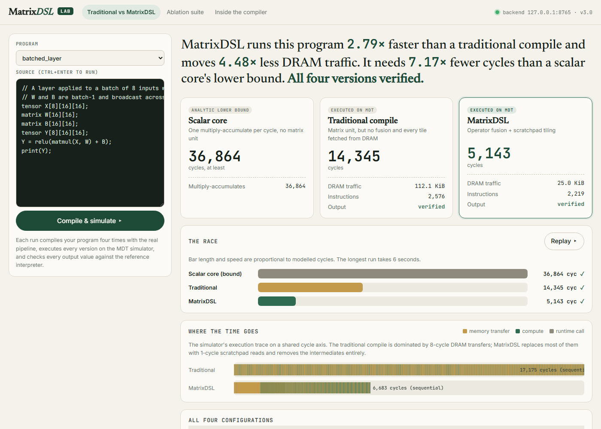

# MatrixDSL

**A matrix language, a tensor-level compiler, and the matrix ISA it targets, designed together.**

| | |
|---|---|
| **Course** | BCSE307P Compiler Design |
| **Project ID** | A3 · Team 13 |
| **Target** | MDT (MatrixDSL Target): a custom matrix ISA with a 64 KiB scratchpad |
| **Status** | Final review (Phase 3): complete end-to-end pipeline, 70/70 tests, measured ablation study |
| **Final report** | [`docs/review3/Final_Report.pdf`](docs/review3/Final_Report.pdf) (IEEE format; source [`Final_Report_IEEE.html`](docs/review3/Final_Report_IEEE.html), [markdown](docs/review3/Final_Report.md)) |

```
matrix X[16][16];  matrix W1[16][16];  matrix B1[16][16];
matrix W2[16][16]; matrix B2[16][16];  matrix H[16][16];  matrix Y[16][16];
H = relu(matmul(X, W1) + B1);
Y = matmul(H, W2) + B2;
print(Y);
```

`matrixdslc mlp_16.mtx --run --perf --verify` lexes, parses and shape-checks
this program, lowers it to an SSA Tensor IR, fuses `relu(X·W1 + B1)` into a
single op, stages the reused weight tiles in the scratchpad, and generates MDT
assembly. It then runs that assembly on the MDT simulator, prints `Y`, reports
the cycle model, and checks every value against a reference interpreter.

---

## Team

| Member | Register No. | Owns |
|---|---|---|
| Vinay A | 24BCB0131 | Lexer, parser, AST, diagnostics, compiler driver (`matrixdslc`) |
| Mudpe Parth Tulsidas | 24BDS0353 | Semantic analysis, symbol table, differential testing (`mtxverify`) |
| Kandi Jeevitesh Reddy | 24BCE0350 | Tensor IR, lowering, fusion / DCE / tiling passes, reference interpreter, LLVM IR |
| Shreyas Mandem | 24BCE0381 | MDT ISA, code generator, simulator and runtime, ablation study (`mtxbench`) |

---

## The pipeline

```
 .mtx ─ Lexer ─ Parser ─ AST ─ SemanticAnalyzer        shape is the type
      ─ lowerToTensorIR                                SSA Tensor IR, 19 op kinds
      ─ FusionPass ─ DeadCodeElimination ─ TilingPass  matmul epilogues, scratchpad staging
      ─ MDT code generator                             tiles, layout, MATMULACC/MATMULRELU
      ─ mdtsim                                         execution + performance model
                       ▲
 reference interpreter ┘  every result checked (mtxverify, mtxbench)
```

## Results (measured, every run verified)


| Configuration | Geo-mean speed-up | Geo-mean DRAM reduction |
|---|---:|---:|
| operator fusion | 1.20x | 1.22x |
| scratchpad tiling | 1.70x | 2.64x |
| **fusion + tiling** | **2.19x** | **3.79x** |

* **Fusion and tiling are super-additive.** On the batch-8 layer they give
  1.40x and 1.55x separately but 2.79x together.
* **There is a scratchpad capacity cliff.** Tiling gives 3.00x at 64x64 but
  only 1.70x at 128x128, once an operand fills the whole 64 KiB.
* **There is an ISA gap.** Softmax needs a lane-wise `VMAX` and a broadcast
  divide that MDT lacks (`docs/runtime-abi.md`).

The full tables are in [`docs/review3/results.md`](docs/review3/results.md).
Cycle counts come from an analytical model, **not cycle-accurate hardware**.
They compare strategies; they do not predict silicon.

---

## Build and run

Requires only CMake ≥ 3.16 and a C++17 compiler (GCC, Clang, or MSVC).

```bash
cmake -S . -B build -DCMAKE_BUILD_TYPE=Release
cmake --build build -j
ctest --test-dir build                                  # 70 tests

build/bin/matrixdslc examples/ai_layer.mtx --run --perf --verify
build/bin/matrixdslc benchmarks/workloads/mlp_16.mtx --emit-tir -o -
build/bin/matrixdslc benchmarks/workloads/matmul_32.mtx --stats
build/bin/mtxverify tests/e2e examples benchmarks/workloads
build/bin/mtxbench benchmarks/workloads --md results.md --csv results.csv
```

### MatrixDSL Lab (visual dashboard and Chrome extension)

```bash
build/bin/mtxserve        # then open http://127.0.0.1:8765/
```



The Lab puts a traditional compile and MatrixDSL side by side and reruns the
whole ablation study live. To use it as a Chrome extension, load `extension/`
from `chrome://extensions` with Developer mode on and **Load unpacked**. See
[`extension/README.md`](extension/README.md).

| Tool | What it does |
|---|---|
| `mtxserve` | Local backend for the Lab: the real pipeline as a JSON API on 127.0.0.1 |
| `matrixdslc` | The compiler: `--emit-tokens/-ast/-tir/-llvm`, `-S`, `--run`, `--perf`, `--verify`, `--stats`, `--no-fusion`, `--no-tiling`, `-O0` |
| `mdtsim` | MDT assembler and simulator (`--perf`, `--trace`, `--dump-matrix`) |
| `mtxverify` | Compiles each program 4 ways, runs it, and compares with the reference interpreter |
| `mtxbench` | The fusion × tiling ablation study |
| `mtxlex`, `mtxparse`, `mtxcheck`, `mtxtensorir`, `mtxref` | Per-stage tools from Reviews 1-2 |

---

## Repository layout

| Path | Contents |
|---|---|
| `compiler/frontend/` | lexer, parser, AST, semantic analysis, diagnostics |
| `compiler/tensor-ir/` | Tensor IR, lowering, fusion, DCE, tiling, reference interpreter |
| `compiler/backend/` | Tensor IR → MDT code generator |
| `compiler/llvm/` | LLVM IR text emitter, plus the Review 1 LLVM API interfaces |
| `compiler/driver/` | the `Pipeline` shared by every tool |
| `tools/` | `matrixdslc`, `mdtsim`, `mtxverify`, `mtxbench`, `mtxserve`, per-stage tools |
| `extension/` | MatrixDSL Lab: Chrome extension (Manifest V3) and the dashboard it opens |
| `llvm-backend/MDT/` | TableGen target description (`-DMATRIXDSL_WITH_LLVM=ON`) |
| `benchmarks/workloads/` | the eight ablation workloads |
| `tests/` | lexer, parser, semantic, backend `.s`, driver suites, `e2e/` differential corpus |
| `docs/` | language spec, grammar, ISA, ISA extensions, memory hierarchy, Tensor IR, runtime ABI |
| `docs/review1`, `docs/review2`, `docs/review3` | review reports, contributions, results |

---

## Language at a glance

| Construct | Example |
|---|---|
| Declarations | `matrix A[4][4];`  `tensor X[8][16][16];` (leading batch dimension) |
| Literals | `A = [[1, -2], [3, 4.5]];` |
| Operators | `A + B`, `A - B`, `A * B` (matmul), `2.5 * A` (scalar) |
| Builtins | `matmul`, `transpose`, `relu`, `softmax` |
| Output | `print(Y);` |

Shapes are checked at compile time, including batch broadcast: batches must
be equal, or one side must be 1. Matrices that are declared but never assigned
are program inputs, which the toolchain fills with deterministic test values.

---

## Presentations

| File | What it is |
|---|---|
| [`presentation/MatrixDSL-Phase3.html`](presentation/MatrixDSL-Phase3.html) | Phase 2 → Phase 3: what changed, each member's work, and live simulations |
| [`presentation/MatrixDSL-Presentation.html`](presentation/MatrixDSL-Presentation.html) | The whole project explained: language, pipeline, ISA, interactive simulations |
| `Start MatrixDSL Lab.bat` | Windows: builds if needed, starts `mtxserve`, opens the Phase 3 page and the Lab |

Open the HTML files in a browser. With `mtxserve` running, the Phase 3 page's
simulations compile and run live; without it, they replay the recorded,
verified results.

---

## Reviews

| Review | Focus | Report |
|---|---|---|
| 1 | Language, grammar, MDT ISA, architecture, frozen interfaces | [`docs/review1`](docs/review1) |
| 2 | Tensors, softmax, Tensor IR + fusion, 7 new instructions, scratchpad, performance model | [`docs/review2`](docs/review2) |
| 3 | End-to-end compiler, lowering, tiling, code generation, verification, ablation study | [`docs/review3`](docs/review3) |

Licensed under the terms in [`LICENSE`](LICENSE).
