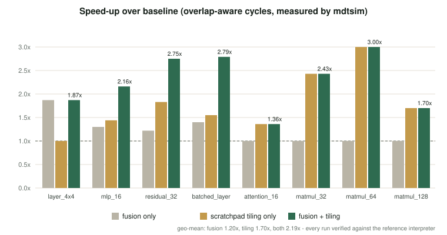

# MatrixDSL: Co-designing a Matrix Language, a Tensor-Level Compiler and a Matrix ISA

**BCSE307P Compiler Design · Project A3 · Team 13 · Final Review (Phase 3)**

Vinay A (24BCB0131) · Mudpe Parth Tulsidas (24BDS0353) · Kandi Jeevitesh Reddy (24BCE0350) · Shreyas Mandem (24BCE0381)

Repository: <https://github.com/shreyasmandem/MatrixDSL>

---

## Abstract

We present MatrixDSL, a small domain-specific language for matrix and neural
network workloads, and a complete compiler that lowers it to **MDT**, a custom
matrix instruction set we designed alongside the compiler. The pipeline has
seven stages: lexing, parsing, shape-as-type semantic analysis, lowering to an
SSA **Tensor IR**, three optimisation passes (operator fusion, dead-code
elimination, scratchpad tiling), MDT instruction selection, and execution on a
simulator with an analytical performance model. Because the language, IR and
ISA were designed together, every fused Tensor IR operation maps to one MDT
instruction sequence.

We validate the compiler by **differential testing**. Every program is compiled
under all four combinations of the two main optimisations, executed on the MDT
simulator, and compared with a reference interpreter. Inputs are chosen so that
FP32 arithmetic is exact. All 25 positive programs (100 compiled variants) match
the reference, and all 6 negative programs are rejected with the expected
diagnostic.

On eight workloads, from a single 4x4 layer to a 128x128 matmul and a
batch-8 layer, fusion alone gives a geometric-mean **1.20x** reduction in
modelled cycles. Scratchpad tiling alone gives **1.70x**. The two together give
**2.19x**, with a **3.79x** reduction in DRAM traffic. The combination is
super-additive on fused workloads: 2.79x on the batched layer, against 1.40x
and 1.55x separately. The study also exposes a scratchpad **capacity cliff**
between 64x64 (3.00x) and 128x128 (1.70x), and an ISA gap that prevents
softmax from compiling to straight MDT code.

---

## 1. Introduction

Deep-learning compilers such as XLA, TVM and Triton exist because generic
compilers lose the structure of tensor programs too early. By the time a
matrix multiply has become loops in LLVM IR, the compiler can no longer see
that a multiply followed by a bias add followed by an activation is *one*
computation. It also cannot see that the same weight tile is fetched dozens of
times. Production accelerator stacks avoid this by keeping a tensor-level IR,
fusing producer-consumer chains (the "epilogue" of a matmul), and staging data
in software-managed on-chip memory (for example the TPU's VMEM).

MatrixDSL reproduces this design end to end, at a scale four students can
build, read and measure in one semester:

* **Language.** Shape is the type: `matrix A[4][4];`, batched `tensor X[8][4][4];`,
  and `matmul`, `transpose`, `relu`, `softmax`, `+`, `-`, `*`. Ill-shaped
  programs are rejected at compile time.
* **Compiler.** An SSA Tensor IR with 19 operation kinds. Fusion is guarded by
  use count. Scratchpad tiling is chosen greedily by DRAM bytes saved.
* **Target.** MDT has R0-R15, V0-V7 and eight 4x4 FP32 matrix registers
  M0-M7. It started with 17 instructions and has 24 after Phase 2, plus a
  64 KiB scratchpad. It is executed by `mdtsim` with a transparent,
  not-cycle-accurate performance model.

### Contributions

1. **A complete working pipeline**, from `.mtx` source to executed MDT code.
   It builds with nothing but a C++17 compiler (about 7,800 lines across
   compiler, tools and tests).
2. **Co-designed fused instructions.** `MATMULACC` and `MATMULRELU` exist
   because the fusion pass emits exactly those patterns. Phase 3 adds
   epilogue fusion (`relu(A·B + C)` as one Tensor IR op) without a new opcode.
3. **An ISA reuse trick.** The matrix unit's accumulate path also serves as a
   tile adder: `A + B` lowers to `MATMULACC` against a resident identity tile.
   That is 3 instructions per tile instead of 16 vector instructions.
4. **A verification methodology** that makes compiled output bit-comparable to
   a reference: exact-arithmetic input generation plus four-way configuration
   testing.
5. **A measured ablation study** with three findings: super-additive
   fusion-tiling synergy, a scratchpad capacity cliff, and an ISA gap for softmax.

---

## 2. System overview

```
 .mtx source
   │ Lexer ─ Parser ─ AST                            Vinay A
   │ SemanticAnalyzer (shape = type, batch rules)    Mudpe Parth Tulsidas
   ▼
 Tensor IR (SSA)  ← lowerToTensorIR                   Kandi Jeevitesh Reddy
   │ FusionPass → DeadCodeElimination → TilingPass
   ▼
 MDT code generator (instr. selection, layout)       Shreyas Mandem
   ▼
 MDT assembly ─ mdt::Assembler ─ mdt::Simulator ─ performance model
                                     ▲
 Reference interpreter (oracle) ─────┘ compared by mtxverify / mtxbench
```

| Tool | Purpose |
|---|---|
| `matrixdslc` | The compiler: `--emit-tokens/-ast/-tir/-llvm`, `-S`, `--run --perf --verify`, `--no-fusion`, `--no-tiling` |
| `mdtsim` | Assembler + simulator + performance model (`--perf`) |
| `mtxverify` | Differential tester: 4 configurations vs. the reference interpreter |
| `mtxbench` | The ablation study; writes `results.md` / `results.csv` |
| `mtxlex`, `mtxparse`, `mtxcheck`, `mtxtensorir`, `mtxref` | Per-stage tools from Reviews 1-2 |

---

## 3. Language and semantic analysis

A program is a sequence of declarations, assignments and prints. The semantic
analyser gives every expression a type `(batch, rows, cols)` and enforces:

| Operation | Rule |
|---|---|
| `A + B`, `A - B` | equal rows and cols; batches equal or one is 1 |
| `matmul(A, B)`, `A * B` | `A.cols == B.rows`; batch broadcast as above |
| `s * A` | one operand 1x1 (scalar multiplication) |
| `transpose(A)` | `(b, r, c) → (b, c, r)` |
| `relu`, `softmax` | shape-preserving; softmax is row-wise |
| dimensions | 1 ≤ rows, cols ≤ 256; 1 ≤ batch ≤ 1024 |

Diagnostics show the source line and a caret:

```
tests/e2e/invalid/matmul_mismatch.mtx:6:5: error: cannot multiply matrix 4x3 with matrix 4x4
  6 | C = matmul(A, B);
    |     ^
  note: matmul requires A.cols == B.rows, but 3 != 4
```

---

## 4. Tensor IR and the optimisation passes

### 4.1 Lowering: variables are names, not storage

`lowerToTensorIR` produces SSA. An assignment *rebinds* a name to the op that
computed it, so `T = matmul(X, W); U = T + B; U = relu(U);` yields the same
graph as `relu(matmul(X, W) + B)`. Named temporaries therefore never block
fusion (`tests/e2e/valid/chained_names.mtx`). Observable behaviour is defined
by `print`. A matrix that is read before it is ever assigned is a program
**input** and becomes a `Load` op.

### 4.2 Operator fusion, guarded by use count

| Pattern | Result | Lowered to |
|---|---|---|
| `MatMul → Relu` | `FusedMatMulRelu(A, B)` | `MATMULRELU` (one k-tile) or `MATMUL`/`MATMULACC` + `RELU` |
| `MatMul → Add(C)` | `FusedMatMulAcc(A, B, C)` | bias tile into the accumulator, `MATMULACC` per k-tile |
| `FusedMatMulAcc → Relu` (Phase 3) | `FusedMatMulRelu(A, B, C)` | as above, then `RELU` **in register** before the single `STORE` |

A pattern fires only if the intermediate has exactly one use. If a value is
also printed, fusing it away would force recomputation
(`tests/e2e/valid/second_use.mtx`). The Phase 3 epilogue pattern turns the
Review 2 "two ops, not three" compromise into one op with no new opcode. On
`layer_4x4` it removes a 64-byte store and reload per tile.

### 4.3 Dead-code elimination

DCE is a reverse sweep from the `Print` roots. It removes the matmuls that
fusion has absorbed, and any value that is never observed.

### 4.4 Scratchpad tiling

For every matmul-family op `C(M×N) = A(M×K) · B(K×N)`, the tile grid is
`Mt × Nt × Kt`. Each A tile is read `Nt` times, plus once per batch when A is
broadcast. Each B tile is read `Mt` times. An operand with reuse greater than 1 is
**staged**: copied DRAM → scratchpad once (`ScratchStore`) and then read with
`SCRATCHLOAD` (`ScratchLoad`). Per tile, this replaces `uses × 8` cycles of
DRAM loads with `8 + 1 + uses × 1`, which is a win whenever `uses ≥ 2`.
Candidates are chosen greedily by DRAM bytes saved within the 64 KiB
capacity, and the scratchpad is reused across consumers.

```
%2 = ScratchStore %0 sp+0 : 32x32
%3 = ScratchLoad %2 : 32x32
%4 = ScratchStore %1 sp+4096 : 32x32
%5 = ScratchLoad %4 : 32x32
%6 = TiledMatMul %3 %5 : 32x32        ; 64 tiles of A and of B, each reused 8x
```

---

## 5. The MDT back end

### 5.1 Memory layout and the zero-padding invariant

Each DRAM-resident value gets one 64-byte-aligned buffer: row-major, with rows
and columns padded up to a multiple of 4 and batches stacked. Tiles are read
with `LOADT Md, [Rbase + off], stride`. **All padding is zero**, and every
instruction sequence preserves this:

* adding zeros gives zero;
* a zero row of A or zero column of B gives a zero product row or column;
* `relu(0) = 0`;
* `mdt_softmax` writes zeros explicitly.

Ragged shapes such as 3x5 or 5x3·3x7 therefore run on a 4x4 matrix unit
exactly, with no masking.

### 5.2 Instruction selection

| Tensor IR | MDT, per output tile |
|---|---|
| `MatMul` / `TiledMatMul` | `MATMUL`, then `MATMULACC` for each further k-tile |
| `FusedMatMulAcc` | `LOAD M0 ← C`; `MATMULACC` × k |
| `FusedMatMulRelu` | `MATMULRELU` (k = 1, no bias) or accumulate + `RELU M0, M0` |
| `Add` / `Sub` | `MATMULACC M0, M1, M7` with `M7 = +I` (or `M6 = −I`) |
| `ScalarMul` | `MATMUL M0, M1, M5` with `M5 = s·I` |
| `Transpose` | `TRANSPOSE` on tile (j, i) → (i, j) |
| `Relu` | `RELU` |
| `Softmax`, `Print` | runtime calls `mdt_softmax`, `mdt_print` (`docs/runtime-abi.md`) |
| `ScratchStore` | `LOAD M3` + `SCRATCHSTORE` per tile, once |

**The identity trick.** MDT has no matrix add. A 4-lane `VADD` sequence would
need 4 × (2 loads + add + store) = 16 instructions per tile, and each load pays
the full 8-cycle DRAM latency. Instead, with `+I` resident in `M7`,
`MATMULACC M0, M1, M7` computes `M0 + M1·I = M0 + M1` exactly. Every product
is either `x·1` or `x·0`, so no rounding is introduced. The cost is 3
instructions per tile.

Register plan: `M0` accumulator, `M1`/`M2` operands, `M3` staging, `M5`
scale, `M6` −I, `M7` +I. `R1`-`R3` hold operand bases and `R4` the result
base.

### 5.3 LLVM IR

`--emit-llvm` writes a textual module that calls the reserved `@mdt.*` tile
intrinsics fixed in Review 1 (`docs/llvm-backend.md`). This keeps the
documented LLVM path inspectable without linking LLVM. The TableGen target
description (`llvm-backend/MDT`) remains available via `-DMATRIXDSL_WITH_LLVM=ON`.

---

## 6. Verification methodology

A compiler that produces fast wrong code is worthless, so every measurement in
Section 7 is gated on correctness.

1. **Oracle.** `tensorir::interpret` evaluates the *unoptimised* Tensor IR in
   FP32 on the host. It has no tiles, no registers and no scratchpad, so it
   shares none of the code under test.
2. **Exact inputs.** Program inputs are generated from a seeded LCG as
   multiples of 1/8 in [−2, 2]. Products are multiples of 1/64, and all sums
   at the sizes we run stay far below 2^24 units. FP32 is therefore exact
   regardless of summation order, and any difference is a real bug, not
   rounding. Only programs containing `softmax` depend on rounding, and the
   runtime and the oracle share the same operation order.
3. **Four-way testing.** `mtxverify` compiles every program under {baseline,
   fusion, tiling, fusion + tiling}, runs each on `mdtsim`, and compares every
   `print` (tolerance 10⁻⁵ relative).
4. **Negative tests.** Programs whose first line says `expect: error` must be
   rejected, and their diagnostics must contain each `expect-error:` string.

| Suite | Count | Result |
|---|---:|:---:|
| CTest (lexer, parser, semantic, reference, 17 hand-written MDT programs, driver suites, e2e, bench) | 70 tests | **70/70** |
| `mtxverify` positive programs × 4 configurations | 25 × 4 = 100 runs | **100/100** |
| `mtxverify` negative programs | 6 | **6/6** |
| `mtxbench` runs (8 workloads × 4) | 32 | **32/32 verified** |

The differential tests caught real defects during integration. The lexer was
missing the Phase 2 `tensor` and `softmax` keywords. The parser rejected
negative literals. The symbol table leaked shadowed names after `popScope`.
The integration test driver had a Windows quoting bug. All of them are fixed
in this release.

---

## 7. Evaluation

**Setup.** We use the eight workloads in `benchmarks/workloads/`. Every number
below is printed by `mtxbench` from an executed program whose output matched
the oracle. Cycles come from the MDT analytical model:

* Latencies: DRAM load/store 8, scratchpad 1, matmul family 4, vector,
  transpose, relu and reductions 2, scalar and control 1.
* Overlap: the instruction trace is run-length-encoded into transfer and
  compute runs, and each adjacent pair costs `max` rather than the sum.

The model is **not cycle-accurate**. It measures the relative effect of
code-generation strategies, which is the question here.



| Workload | Config | Instr | DRAM bytes | Cycles (overlap) | Speed-up | DRAM reduction |
|---|---|---:|---:|---:|---:|---:|
| `layer_4x4` | baseline | 27 | 576 | 73 | 1.00x | 1.00x |
| | fusion | 17 | 256 | 39 | **1.87x** | 2.25x |
| | tiling | 27 | 576 | 73 | 1.00x | 1.00x |
| | both | 17 | 256 | 39 | 1.87x | 2.25x |
| `mlp_16` | baseline | 614 | 26,688 | 3,337 | 1.00x | 1.00x |
| | fusion | 479 | 20,480 | 2,567 | 1.30x | 1.30x |
| | tiling | 742 | 14,400 | 2,317 | 1.44x | 1.85x |
| | both | 607 | 8,192 | 1,543 | **2.16x** | 3.26x |
| `residual_32` | baseline | 2,064 | 90,176 | 11,273 | 1.00x | 1.00x |
| | fusion | 1,738 | 73,728 | 9,223 | 1.22x | 1.22x |
| | tiling | 2,320 | 32,832 | 6,155 | 1.83x | 2.75x |
| | both | 1,995 | 16,384 | 4,103 | **2.75x** | 5.50x |
| `batched_layer` (8×16×16) | baseline | 2,576 | 114,752 | 14,345 | 1.00x | 1.00x |
| | fusion | 1,931 | 81,920 | 10,247 | 1.40x | 1.40x |
| | tiling | 2,864 | 58,432 | 9,243 | 1.55x | 1.96x |
| | both | 2,219 | 25,600 | 5,143 | **2.79x** | 4.48x |
| `attention_16` | baseline | 537 | 24,640 | 3,862 | 1.00x | 1.00x |
| | fusion | 537 | 24,640 | 3,862 | 1.00x | 1.00x |
| | tiling | 665 | 12,352 | 2,838 | 1.36x | 1.99x |
| | both | 665 | 12,352 | 2,838 | 1.36x | 1.99x |
| `matmul_32` | baseline | 1,610 | 69,632 | 8,711 | 1.00x | 1.00x |
| | tiling | 1,866 | 12,288 | 3,591 | **2.43x** | 5.67x |
| `matmul_64` | baseline | 12,554 | 540,672 | 67,591 | 1.00x | 1.00x |
| | tiling | 13,578 | 49,152 | 22,535 | **3.00x** | 11.00x |
| `matmul_128` | baseline | 99,338 | 4,259,840 | 532,487 | 1.00x | 1.00x |
| | tiling | 101,386 | 2,228,224 | 312,327 | 1.70x | 1.91x |

(For pure matmuls fusion has nothing to fuse, so "fusion" equals baseline and
"both" equals "tiling". The full table is in `results.md` and `results.csv`.)

| Configuration | Geo-mean speed-up | Geo-mean DRAM reduction |
|---|---:|---:|
| fusion | 1.20x | 1.22x |
| scratchpad tiling | 1.70x | 2.64x |
| **fusion + tiling** | **2.19x** | **3.79x** |

### 7.1 Findings

**F1: Fusion and tiling are super-additive.** On `batched_layer` the two
separately give 1.40x and 1.55x, but together give 2.79x, more than their
product (2.17x). Fusion removes the materialised intermediates. What remains
is dominated by weight-tile reads, which is exactly what tiling attacks. The
broadcast weight is reused 8 × 4 = 32 times per tile, so staging it is very
valuable once the store and reload traffic around it is gone.

**F2: There is a scratchpad capacity cliff.** Tiling's benefit grows with reuse
from 32x32 (2.43x) to 64x64 (3.00x, 11x less DRAM traffic), then **falls** at
128x128 (1.70x). Each 128x128 operand is exactly 64 KiB, so the greedy pass
can stage only one of them (`--stats` says so). This is the classic argument
for a second blocking level: stage scratchpad-sized panels rather than whole
operands. We leave it as future work and measure its absence honestly.

**F3: Tiling adds instructions but removes cycles.** Staging adds 11-24% more
instructions (`matmul_32`: 1,610 → 1,866), yet cycles fall 2.4x, because
8-cycle DRAM loads become 1-cycle scratchpad loads. Instruction count is the
wrong metric for a memory-bound accelerator, which is why the model reports
bytes and cycles.

**F4: Fusion without an epilogue pattern does nothing for attention.**
`attention_16` gains nothing from fusion: its chain is
`MatMul → ScalarMul → Softmax`, and none of those are fusible pairs. A scale
epilogue (fold `s` into the accumulator) and a softmax epilogue (online
softmax, as in FlashAttention) are the natural next patterns.

**F5: The ISA lacks two instructions softmax needs.** `MROWMAX` and `MROWSUM`
reduce one tile, but a row wider than 4 spans several tiles. Combining
per-tile maxima needs a lane-wise `VMAX`, and normalising needs a
row-broadcast divide. Softmax is therefore a runtime call
(`docs/runtime-abi.md`). The compiler pinpoints the minimal ISA extension
rather than guessing it.

### 7.2 Interactive reproduction: MatrixDSL Lab

Every table in this section can be reproduced visually. `mtxserve` exposes the
pipeline as a local JSON API. The Lab dashboard, opened in a browser tab or
from the bundled Chrome extension (`extension/`), compiles any program under
all four configurations and shows the traditional and optimised runs side by
side: modelled cycles, DRAM traffic, the simulator's transfer/compute timeline,
Tensor IR and assembly. It also reruns the full ablation study, with every run
verified.

### 7.3 Threats to validity

* The cycle model is analytical, has no contention or bandwidth limits, and
  costs runtime calls by a fixed per-element rate. Conclusions are about
  *relative* costs.
* Code is generated straight-line (fully unrolled), so loop overhead is absent
  in all configurations alike.
* There is one fixed tile size (4x4) and one scratchpad size (64 KiB). The
  capacity cliff in F2 will move with the scratchpad size.
* Inputs are synthetic. Correctness does not depend on the values, and the
  model's cycle and byte counts do not depend on them at all.

---

## 8. Related work

XLA's operator fusion (Snider & Liang, 2023) and TVM's tensor-level scheduling
(Chen et al., 2018) are the production analogues of our fusion and tiling
passes. Halide (Ragan-Kelley et al., 2013) introduced the separation of
algorithm and schedule that our "same program, four configurations" study
relies on. Triton (Tillet et al., 2019) and MLIR (Lattner et al., 2021) keep a
tile- or tensor-level IR above LLVM, as our Tensor IR does. The TPU (Jouppi et
al., 2017) pairs a matrix unit with software-managed on-chip memory, the model
for MDT's matrix registers and scratchpad. Blocking for reuse goes back to Lam
et al. (1991). BF16 storage follows Kalamkar et al. (2019). The softmax
epilogue in F4 is the online-normaliser idea of Milakov & Gimelshein (2018)
used by FlashAttention (Dao et al., 2022). Our verification is differential
testing in the sense of McKeeman (1998) and Csmith (Yang et al., 2011).

---

## 9. Limitations and future work

1. **Second-level blocking** to remove the 128x128 capacity cliff (F2).
2. **Scale and softmax epilogues** for attention (F4).
3. **`VMAX` + row-broadcast divide**, so that softmax compiles to MDT code (F5).
4. **Loop generation** instead of full unrolling, to bound code size
   (`matmul_128` is about 100k static instructions).
5. **The real LLVM path**: `MDTISelLowering` lowering the `@mdt.*` intrinsics
   that `--emit-llvm` already emits.

---

## 10. Team contributions (Phase 3)

| Member | Phase 3 work | Evidence |
|---|---|---|
| **Vinay A** | `matrixdslc` driver and `Pipeline` used by every tool; caret diagnostics; Phase 2 keywords wired into the lexer; negative literals | `tools/mtxc`, `compiler/driver`, `compiler/frontend/Diagnostics.*`; 28 lexer/parser CTests |
| **Mudpe Parth Tulsidas** | `mtxverify` differential tester; the e2e corpus (11 positive, 6 negative); symbol-table scope fix | `tools/mtxverify`, `tests/e2e`; 9 semantic CTests; 100/100 verified runs |
| **Kandi Jeevitesh Reddy** | AST → Tensor IR lowering; epilogue fusion; DCE; scratchpad tiling pass; reference interpreter; LLVM IR text emitter | `compiler/tensor-ir/{Lowering,Passes,Interpreter}.*`, `compiler/llvm/LLVMTextEmitter.*` |
| **Shreyas Mandem** | MDT code generator (instruction selection, layout, identity trick); simulator runtime ABI; `mtxbench` ablation study; integration; MatrixDSL Lab (`mtxserve` + Chrome extension) | `compiler/backend`, `tools/mdtsim`, `tools/mtxbench`, `docs/runtime-abi.md`; 17 backend tests |

---

## 11. Reproducing every number

```bash
cmake -S . -B build -DCMAKE_BUILD_TYPE=Release
cmake --build build -j
ctest --test-dir build                       # 70/70
build/bin/mtxverify tests/e2e examples benchmarks/workloads
build/bin/mtxbench benchmarks/workloads --md results.md --csv results.csv
build/bin/matrixdslc benchmarks/workloads/mlp_16.mtx --run --perf --verify --stats
```

---

## References

1. D. Snider, R. Liang. *Operator Fusion in XLA: Analysis and Evaluation.* arXiv:2301.13062, 2023.
2. T. Chen et al. *TVM: An Automated End-to-End Optimizing Compiler for Deep Learning.* OSDI 2018.
3. J. Ragan-Kelley et al. *Halide: A Language and Compiler for Optimizing Parallelism, Locality, and Recomputation in Image Processing Pipelines.* PLDI 2013.
4. P. Tillet, H. T. Kung, D. Cox. *Triton: An Intermediate Language and Compiler for Tiled Neural Network Computations.* MAPL 2019.
5. C. Lattner et al. *MLIR: Scaling Compiler Infrastructure for Domain Specific Computation.* CGO 2021.
6. C. Lattner, V. Adve. *LLVM: A Compilation Framework for Lifelong Program Analysis and Transformation.* CGO 2004.
7. N. P. Jouppi et al. *In-Datacenter Performance Analysis of a Tensor Processing Unit.* ISCA 2017.
8. M. S. Lam, E. E. Rothberg, M. E. Wolf. *The Cache Performance and Optimizations of Blocked Algorithms.* ASPLOS 1991.
9. D. Kalamkar et al. *A Study of BFLOAT16 for Deep Learning Training.* arXiv:1905.12322, 2019.
10. M. Milakov, N. Gimelshein. *Online Normalizer Calculation for Softmax.* arXiv:1805.02867, 2018.
11. T. Dao et al. *FlashAttention: Fast and Memory-Efficient Exact Attention with IO-Awareness.* NeurIPS 2022.
12. W. M. McKeeman. *Differential Testing for Software.* Digital Technical Journal 10(1), 1998.
13. X. Yang, Y. Chen, E. Eide, J. Regehr. *Finding and Understanding Bugs in C Compilers.* PLDI 2011.
